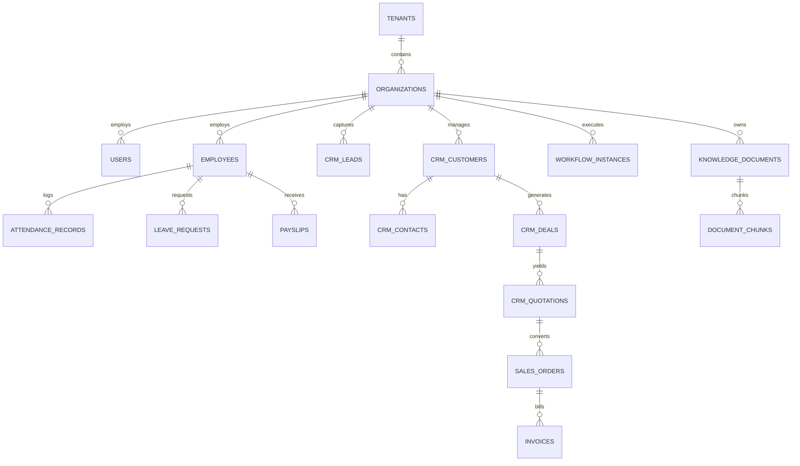

# VertexERP AI — Database Architecture & Schema Design

## 1. Core Principles
- **Multi-Tenant Isolation**: Every primary entity table contains `tenant_id` and `organization_id` foreign keys with non-null constraints and database indexes.
- **PostgreSQL Row-Level Security (RLS)**: Enforced via `ALTER TABLE ... ENABLE ROW LEVEL SECURITY;` using session variables `app.current_tenant_id` and `app.is_superuser`.
- **Audit Columns**: Standard audit fields on all business tables: `created_at`, `updated_at`, `deleted_at`, `is_deleted`, `version`.
- **Decimal Precision**: All monetary fields stored as `NUMERIC(14, 2)` or `NUMERIC(16, 4)`. Floating point types are prohibited for financials.
- **Alembic Migrations**: All schema modifications are version-controlled and reversible.

---

## 2. Entity-Relationship Domain Model

---

## 3. Schema Catalog by Business Domain

### 3.1. Identity, Organization & Access Control
- `tenants`: Primary tenant account, subscription tier, status.
- `organizations`: Legal entity, tax registration, headquarters address.
- `branches`: Physical operating branches, locations.
- `departments`: Functional departments (Sales, Engineering, HR, Finance).
- `designations`: Job titles, salary bands, hierarchy.
- `users`: Authentication identities, password hashes, email, phone, status.
- `roles` & `permissions`: RBAC matrix and role assignments.
- `audit_logs`: Immutable security and data mutation logs.

### 3.2. Human Resource Management System (HRMS)
- `employees`: Core employee profile, personal details, hire date, status.
- `shifts` & `shift_assignments`: Work schedules, start/end times, grace periods.
- `attendance_records`: Date, punch-in, punch-out, total hours, break duration, status (`PRESENT`, `ABSENT`, `ON_DUTY`, `HOLIDAY`, `LEAVE`).
- `attendance_regularizations`: Correction requests for missing punch or dispute.
- `leave_types`: Vacation, Sick, Casual, Maternity, Unpaid.
- `leave_policies`: Entitlements, accrual cadence, carryover rules.
- `leave_balances`: Annual allowances, used days, pending days, remaining days.
- `leave_requests`: Applied dates, reason, status (`PENDING`, `APPROVED`, `REJECTED`).
- `salary_components`: Basic, HRA, Medical, Bonus, Provident Fund, Tax deductions.
- `salary_structures`: Component templates mapped to designations.
- `payroll_runs`: Monthly pay cycle batches, processing status, disbursement dates.
- `payslips`: Individual employee monthly pay breakdown with gross, deductions, and net pay.
- `job_requisitions`: Open job postings, target headcount, department.
- `job_applicants`: Candidate profile, resume link, pipeline stage, AI score.
- `performance_reviews`: Review periods, self/manager appraisals, goals.

### 3.3. Customer Relationship Management (CRM)
- `crm_leads`: Name, company, email, phone, source, status (`NEW`, `CONTACTED`, `QUALIFIED`, `CONVERTED`), AI score.
- `crm_customers`: Accounts / Corporate clients, industry, website, credit terms.
- `crm_contacts`: Decision makers, phone, email, designation.
- `crm_deals`: Opportunities, pipeline stage, deal value, probability, expected close date, status (`OPEN`, `WON`, `LOST`).
- `crm_pipeline_stages`: Pipeline stages with sequence and probability.
- `crm_activities`: Calls, meetings, emails, tasks, notes, follow-ups.
- `crm_quotations` & `crm_quotation_items`: Quote proposals, pricing, tax, validity date.
- `sales_orders` & `sales_order_items`: Confirmed client orders converted from quotes.
- `invoices` & `payments`: Billing invoices, line items, payment records.

### 3.4. Workflow & Approval Engine
- `workflow_definitions`: Approval templates for `LEAVE`, `ATTENDANCE_REGULARIZATION`, `EXPENSE`, `QUOTATION`.
- `workflow_steps`: Sequential approval levels with designated approver roles or managers.
- `workflow_instances`: Active approval processes linked to business records.
- `approval_actions`: Immutable trail of actions (`APPROVED`, `REJECTED`, `RETURNED`) with timestamps and comments.

### 3.5. Vertex AI, RAG & Machine Learning
- `ai_conversations` & `ai_messages`: User chat history with Copilot.
- `ai_usage_logs`: Token consumption, latency, and cost telemetry.
- `rag_documents`: Knowledge base documents, access levels, metadata tags.
- `rag_document_chunks`: Text chunks with pgvector embeddings (`vector(1536)`).
- `ml_models` & `ml_predictions`: Registered models, version tags, inference logs for lead scoring, attrition risk, and sales forecasting.
- `candidate_resume_analyses`: Parsed candidate skills, education, experience, and job-match scores.
