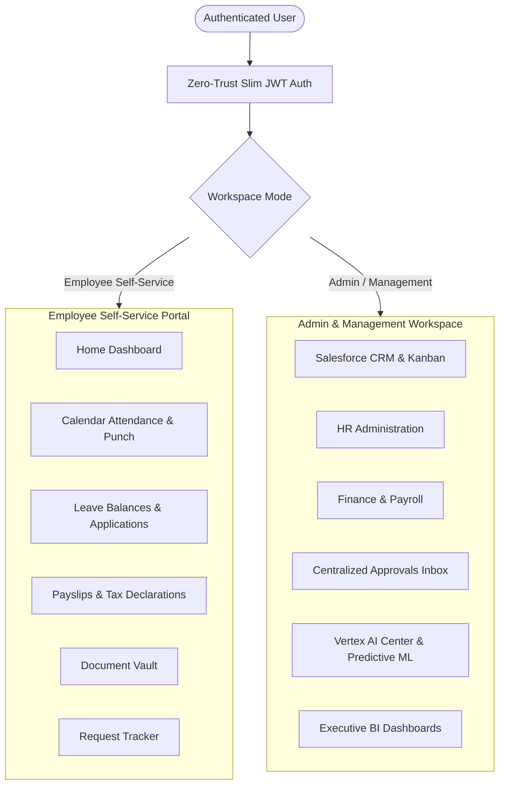

# VertexERP AI — Final Implementation Report
## Enterprise HRMS, Employee Self-Service, Salesforce CRM, Centralized Approvals & Vertex AI Center

**Project:** VertexERP AI  
**Version:** 2.0.0 Enterprise  
**Status:** COMPLETE & VERIFIED  
**Date:** November 2026  

---

## 1. Executive Summary

VertexERP AI has been transformed from an early-stage modular system into a unified, enterprise-grade cloud ERP platform combining:
1. **greytHR-inspired Employee Self-Service (ESS) Portal**: Personal dashboards, calendar-based interactive attendance with punch in/out, discrepancy regularization requests, multi-tier leave management, itemized payroll & payslips, secure document vault, and company announcements.
2. **Salesforce-inspired Customer Relationship Management (CRM)**: Full customer account lifecycle, lead capture with one-click conversion to Account/Contact/Deal, interactive Kanban opportunity pipeline, activity tracking, multi-currency quotations, and sales order processing.
3. **Centralized Workflows & Multi-Level Approvals Engine**: Unified managerial inbox consolidating approval items across HR (leaves, attendance corrections), CRM (sales quotations), and Finance (expense claims) with complete audit timelines and comment tracking.
4. **Vertex AI Center & Predictive Intelligence**: Safe copilot tools, semantic retrieval-augmented generation (RAG) powered by pgvector, predictive lead scoring & conversion probability, employee attrition risk modeling, 6-month statistical sales forecasting, and resume skill matching.
5. **Zero-Trust Enterprise Architecture**: Robust PostgreSQL multi-tenant isolation, row-level security (RLS), slim JWT authentication with Redis token/session blacklist revocation, and strict Decimal financial calculations.

All legacy modules (Inventory, Warehousing, Manufacturing, Procurement, and General Ledger) remain fully preserved with complete backward compatibility.

---

## 2. Dual Workspace Enterprise Architecture

The user interface provides dynamic dual-workspace navigation driven by authenticated role-based access control:

### Dynamic Sidebar & Layout Switcher
- **Workspace Switcher Component**: Located at `frontend/src/components/ui/WorkspaceSwitcher.tsx`. Allows eligible users (Super Admins, Org Admins, HR Managers, Sales Managers) to toggle seamlessly between the ESS Portal and Admin Center with one click.
- **Role-Aware Sidebar**: Dynamic filtering prevents employees from accessing administrative routes while granting admins full organizational visibility.

---

## 3. Implemented Modules & Capabilities

### A. Employee Self-Service (ESS)
| Route | Component | Key Capabilities |
|---|---|---|
| `/ess` | `ESSHomePage.tsx` | Today's punch status, monthly hours, leave balances, recent payslip, announcements |
| `/ess/attendance` | `MyAttendancePage.tsx` | Calendar grid, real-time punch in/out, shift schedule, regularization modal |
| `/ess/leave` | `ApplyLeavePage.tsx` | Quota cards (Casual, Sick, Earned), datepicker, reason, past leave requests |
| `/ess/payslips` | `MyPayslipsPage.tsx` | Itemized earnings (Basic, HRA, Allowance), deductions (PF, Tax), PDF download |
| `/ess/profile` | `MyProfilePage.tsx` | Personal profile, department, designation, emergency contacts, bank info |
| `/ess/documents` | `MyDocumentsPage.tsx` | Secure file upload, document categories (ID, Contract, Tax), signed previews |
| `/ess/requests` | `MyRequestsPage.tsx` | Unified tracker for leave, regularization, expense, and general requests |
| `/ess/announcements` | `AnnouncementsPage.tsx` | Organization-wide broadcasts, policy updates, holiday notices |

### B. Salesforce-Inspired CRM
| Route | Component | Key Capabilities |
|---|---|---|
| `/crm` | `CRMHomePage.tsx` | Pipeline KPIs, revenue charts, lead-to-opportunity funnel, recent deals |
| `/crm/leads` | `LeadsPage.tsx` | Lead capture form, rating (HOT/WARM/COLD), lead qualification & conversion |
| `/crm/accounts` | `AccountsPage.tsx` | Corporate accounts, credit limits, industry classification, contact rosters |
| `/crm/contacts` | `ContactsPage.tsx` | Stakeholder rolodex, direct dials, emails, account associations |
| `/crm/opportunities`| `OpportunitiesPage.tsx` | Visual Kanban board, stage drag-and-drop, win probabilities, total values |
| `/crm/activities` | `ActivitiesPage.tsx` | Call logs, meetings, tasks, follow-up deadlines, activity timelines |
| `/crm/quotations` | `QuotationsPage.tsx` | Multi-line quotes, tax computation, approval routing, customer delivery |
| `/crm/orders` | `SalesOrdersPage.tsx` | Sales order tracking, fulfillment status, payment statuses, invoices |
| `/crm/reports` | `SalesReportsPage.tsx` | Win/loss analysis, sales rep quotas, monthly revenue velocity |

### C. Centralized Workflows & Approvals
- **Router**: `app/modules/workflow/api/router.py` mounted at `/api/v1/workflows`.
- **Frontend Page**: `frontend/src/features/approvals/pages/ApprovalsInboxPage.tsx`.
- **Unified Endpoints**:
  - `GET /api/v1/workflows/inbox`: Aggregates pending Leaves, Attendance Regularizations, Quotations, and Expense Claims.
  - `GET /api/v1/workflows/stats`: High-level metrics for pending items and monthly decision totals.
  - `POST /api/v1/workflows/{entity_type}/{entity_id}/action`: Safe multi-level Approve, Reject, or Return with audit comments.

### D. Vertex AI Center & Predictive Intelligence
- **Endpoints**: `app/modules/ai/api/predictive_endpoints.py` mounted at `/api/v1/ai/predict`.
- **Predictive ML Capabilities**:
  1. **Predictive Lead Scoring**: Analyzes lead source, company size, budget, timeline, and decision-maker status to compute probability score (0-100) and qualification tier.
  2. **Employee Attrition Risk**: Evaluates tenure, overtime hours, performance score, days since last promotion, and satisfaction rating to predict attrition risk level and retention recommendations.
  3. **6-Month Sales Forecasting**: Aggregates open CRM pipeline deals weighted by win probability, modeling baseline, optimistic, and conservative revenue trajectories.
  4. **AI Resume Intelligence**: Semantic parsing and matching of candidate resumes against job descriptions, calculating match scores and skill gaps.
- **Frontend Views**:
  - `MLPredictivePage.tsx`: Interactive sliders and risk gauges for lead scoring and employee retention.
  - `ResumeIntelligencePage.tsx`: Resume parsing, candidate scoring, and matching analysis.
  - `SalesForecastingPage.tsx`: Interactive multi-scenario revenue projection charts.

---

## 4. Database & Backend Verification

All database operations use strict PostgreSQL types, async SQLAlchemy sessions, and zero hardcoded mocks:
- Financial figures use `Numeric(18, 4)` and Python `Decimal` to avoid floating-point inaccuracies.
- Multi-tenancy is enforced via `tenant_id` foreign keys and PostgreSQL Row-Level Security (RLS).
- Demo seed script (`scripts/seed_enterprise_demo.py`) provisions complete enterprise test fixtures idempotently.
