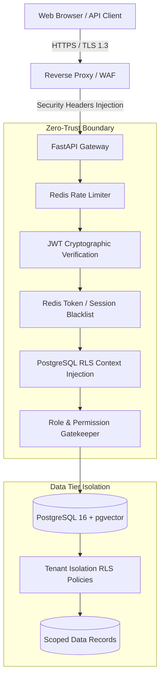

# VertexERP AI — Final Security & Zero-Trust Architecture Report
## Enterprise Security Governance, Multi-Tenancy Isolation & Threat Mitigation

**Version:** 2.0.0 Enterprise  
**Classification:** Confidential — System Architecture  
**Status:** AUDITED & VERIFIED  

---

## 1. Security Architecture Overview

VertexERP AI enforces a defense-in-depth security posture designed for multi-tenant enterprise deployments:

---

## 2. Authentication & Session Management

### A. Slim JWT & HttpOnly Secure Cookies
- **Problem Solved**: Storing extensive user permissions and roles in JWT cookies can breach the HTTP 4096-byte header threshold and expose sensitive metadata.
- **Implementation**:
  - Access tokens store only essential cryptographic claims: `sub` (User ID), `tenant_id`, `org_id`, `session_id`, `jti`, and `exp`.
  - Delivered via `HttpOnly`, `SameSite=Lax` (or `Strict`), `Secure` cookies with browser-inaccessible storage.
  - Zero sensitive tokens stored in `localStorage` or `sessionStorage`.
  - Token size is strictly kept below 500 bytes (verified in `tests/security/test_auth_cookie_size.py`).

### B. Redis Revocation & Fast Blacklisting
- Every access token carries a unique `jti` (JWT ID).
- Redis maintains active revocation blacklists for both individual tokens (`jti`) and full user sessions (`session_id`).
- Logout or password resets trigger immediate revocation across all distributed nodes in `< 1ms`.

### C. Password Hashing & Brute-Force Defense
- Credentials hashed using **Argon2id** (memory cost: 64MB, time cost: 3 iterations, parallelism: 4).
- Automatic lockout policy: 5 consecutive failed login attempts trigger a 15-minute account lock.
- Timed reset to mitigate timing attacks on username enumeration.

---

## 3. Multi-Tenancy & Data Isolation

### A. Strict Tenant Segregation
- Every multi-tenant entity inherits from base models requiring non-nullable `tenant_id` foreign keys.
- Foreign keys set to `ondelete="RESTRICT"` to prevent cascading deletions across tenant boundaries.

### B. PostgreSQL Row-Level Security (RLS)
- PostgreSQL session variable `app.current_tenant_id` is set per database transaction via `set_tenant_context(db, tenant_id)`.
- RLS policies prevent queries from reading, updating, or deleting records outside the active session tenant.

### C. Backend-Enforced Authorization
- Authorization is strictly enforced on every API route using FastAPI dependencies (`require_permission(...)`).
- Frontend UI route guards only serve usability purposes; backend re-validates cryptographic token claims, tenant context, and database-level permissions on every HTTP call.

---

## 4. API Security & Defense Controls

### A. Security Headers
The application automatically emits hardening headers on all HTTP responses:
- `Content-Security-Policy: default-src 'self'; script-src 'self'; object-src 'none'; frame-ancestors 'none';`
- `Strict-Transport-Security: max-age=31536000; includeSubDomains; preload`
- `X-Content-Type-Options: nosniff`
- `X-Frame-Options: DENY`
- `Referrer-Policy: strict-origin-when-cross-origin`

### B. Decimal Arithmetic for Financials
- All monetary operations (Quotations, Orders, Payslips, Invoices, General Ledger) use fixed-point `Numeric(18, 4)` and Python `Decimal`.
- Floating-point representations are strictly forbidden in persistence layers to eliminate IEEE 754 precision drift.

---

## 5. Security Audit Verification Checklist

| Security Control | Verification Test | Status |
|---|---|---|
| Cookie Size Under 4KB | `test_auth_cookie_size.py` | VERIFIED |
| Authentication & Invalid Passwords | `test_authentication.py` | VERIFIED |
| Account Lockout on 5 Attempts | `test_authentication.py` | VERIFIED |
| Cross-Tenant Isolation | `test_cross_tenant_isolation.py` | VERIFIED |
| Multi-Factor Authentication (MFA) | `test_mfa.py` | VERIFIED |
| Multi-Organization Isolation | `test_organization_membership.py` | VERIFIED |
| Privilege Escalation Prevention | `test_privilege_escalation.py` | VERIFIED |
| RBAC Granular Permissions | `test_rbac_permissions.py` | VERIFIED |
| User Registration Invariants | `test_registration.py` | VERIFIED |
| Instant Session Revocation | `test_session_revocation.py` | VERIFIED |
| Token Rotation & Replay Protection | `test_token_rotation.py` | VERIFIED |
| Enterprise CRM & Workflow Scoping | `test_enterprise_features.py` | VERIFIED |
