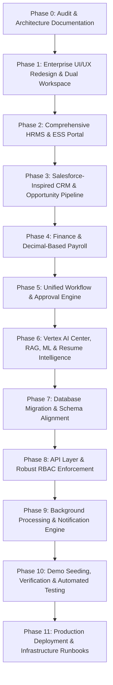

# VertexERP AI — Rebuild & Transformation Master Plan

## 1. Executive Summary & Product Vision
VertexERP AI is being transformed from a foundational multi-tenant ERP prototype into a comprehensive, production-ready enterprise platform that integrates:
1. **Human Resource Management System (HRMS)** with full administrative depth.
2. **Employee Self-Service (ESS)** portal with greytHR-inspired user experience.
3. **Salesforce-inspired Customer Relationship Management (CRM)** with Kanban deal pipelines and quote-to-cash workflows.
4. **Sales & Opportunity Management** with multi-stage pipelines and win/loss tracking.
5. **Finance & Payroll Engine** with Decimal-accurate accounting, salary structures, payslips, and customer invoicing.
6. **Centralized Workflow & Multi-Level Approval Engine** governing leave, regularizations, expenses, and quotations.
7. **Business Intelligence & Executive Analytics** with functional role-specific dashboards.
8. **Vertex AI Center** featuring AI Copilot with permission-enforced tool execution.
9. **Machine Learning & Predictive Analytics** (lead scoring, employee attrition, conversion probability).
10. **Enterprise Retrieval-Augmented Generation (RAG)** knowledge assistant with strict tenant isolation and citations.
11. **AI Resume Intelligence** with automated skill extraction and semantic job matching.
12. **Sales Forecasting** analyzing historical CRM pipeline data.

---

## 2. Dual-Workspace Experience Design
The platform is organized into two primary user experiences powered by the same backend, tenant boundary, and database:

### A. Admin / Management Workspace
For Super Admins, Organization Admins, HR Managers, Sales Managers, and Finance Managers:
- **Global Organization & System Settings**
- **HR Administration & Policy Enforcement**
- **CRM Pipeline & Sales Team Oversight**
- **Finance, Payroll Runs & Invoicing**
- **Centralized Approvals Inbox & Audit Logs**
- **AI Center, Model Management & RAG Administration**

### B. Employee Self-Service (ESS) Workspace
For employees to self-manage daily employment lifecycle activities:
- **Employee Home Dashboard**: Real-time punch widget, attendance calendar summary, leave balances, payslip quick-view.
- **Attendance & Regularization**: Single-click punch in/out, monthly attendance calendar with visual statuses (`P`, `A`, `OD`, `H`, `L`, `R`), regularization requests.
- **Leave Management**: Leave balance cards, policy details, leave application with file attachments and manager routing.
- **My Financials**: Detailed monthly payslips, earnings & deductions breakdown, tax declarations.
- **Documents & Profile**: Personal data, emergency contacts, bank details, official certificates, and company announcements.

---

## 3. Phased Implementation Roadmap

### Phase Milestones & Deliverables
1. **Phase 0 (Complete Audit)**: Full repository inspection, baseline documentation, test discovery.
2. **Phase 1 (UI/UX Redesign)**: Professional light theme default, responsive sidebar, workspace switcher, shared component library (`DataTable`, `StatCard`, `ApprovalTimeline`, `Modal`, `Drawer`).
3. **Phase 2 (HRMS & ESS)**: Dual HR experience (HR Admin + Employee Portal), calendar-based attendance, regularization workflows, shift assignments.
4. **Phase 3 (CRM Platform)**: Lead scoring and conversion, customer/account management, interactive Kanban opportunity board, quotations and sales orders.
5. **Phase 4 (Finance & Payroll)**: Strict Decimal calculation engine, salary components, automated payroll processing runs, PDF-ready payslip schemas.
6. **Phase 5 (Approval Engine)**: State machine supporting `Draft`, `Submitted`, `Pending`, `Approved`, `Rejected`, `Cancelled`, `Returned for Correction`.
7. **Phase 6 (Vertex AI Center)**: Copilot with tool safety guardrails, pgvector RAG indexing with citations, Scikit-learn predictive ML models, AI Resume extraction and job matching.
8. **Phase 7 (Database & RLS)**: Clean SQLAlchemy 2.0 ORM models, tenant-isolated PostgreSQL RLS, Alembic version history.
9. **Phase 8 (API Architecture)**: FastAPI v1 REST routers with Pydantic v2 schemas and fine-grained permission dependencies.
10. **Phase 9 (Jobs & Workers)**: Background job queue with retry mechanisms and dead-letter handling.
11. **Phase 10 (Testing & Seeding)**: Idempotent demo data seeder, comprehensive unit, integration, and frontend tests.
12. **Phase 11 (Operations)**: Production-ready Docker Compose, environment configuration, Windows and Linux execution runbooks.

---

## 4. Architectural Boundaries & Non-Negotiable Constraints
- **Preserve Existing Foundations**: Reuse existing tables (`tenants`, `organizations`, `users`, `employees`, `crm_leads`, `crm_deals`), schemas, and auth infrastructure.
- **De-emphasize Legacy Manufacturing/MRP**: Remove manufacturing and heavy warehousing from the primary navigation while preserving database tables for dependencies.
- **Security & Multi-Tenancy**: Mandatory `tenant_id` and `organization_id` on all business records; Row-Level Security (RLS) policies intact.
- **Zero Floating-Point Financials**: All payroll, taxes, quotation line items, and invoice totals use `Decimal` with explicit rounding.
- **Safe AI & LLM Execution**: No raw SQL generation; AI Copilot executes exclusively through validated, permission-checked Python tools.
