# VertexERP AI — Target Architecture Specification

## 1. Architectural Philosophy & Dual-Workspace Structure
VertexERP AI operates as a unified enterprise web platform featuring:
- **Clean Architecture & Domain-Driven Design (DDD)**
- **Strict Multi-Tenancy & Row-Level Security**
- **Dual Workspace Experience (Admin/Management + Employee Self-Service)**
- **Salesforce-Grade CRM & greytHR-Grade Employee Experience**
- **Safe AI Platform with Predefined Tools and Local ML Pipelines**

```mermaid
graph TB
    subgraph ClientLayer ["Client Layer (React 19 + TypeScript + Tailwind)"]
        AdminWS["Admin / Management Workspace<br/>(HR, CRM, Finance, Approvals, AI, Settings)"]
        ESSWS["Employee Self-Service (ESS)<br/>(Dashboard, Attendance, Leave, Payslips, Documents)"]
        SharedUI["Enterprise Design System<br/>(DataTable, Kanban, Calendars, StatCards, Modals)"]
    end

    subgraph APILayer ["FastAPI v1 API Gateway"]
        AuthMiddleware["Security & Auth Middleware<br/>(JWT, Argon2, Cookie, Rate Limiter, Correlation ID)"]
        V1Routers["Domain Routers<br/>(/auth, /hr, /crm, /finance, /workflows, /ai, /ml)"]
        RBACGuard["Fine-Grained RBAC & Permission Enforcement"]
    end

    subgraph ServiceLayer ["Enterprise Service Layer"]
        HRService["HRMS & Payroll Service (Decimal Math)"]
        CRMService["CRM & Opportunity Pipeline Service"]
        WorkflowService["Unified Workflow & Approval Engine"]
        AIService["Vertex AI Copilot & Safe Tool Calling"]
        RAGService["Knowledge Base RAG & pgvector Indexer"]
        MLService["Machine Learning & Predictive Engine (Scikit-Learn)"]
        ResumeService["AI Resume Intelligence & Skill Matcher"]
    end

    subgraph DataLayer ["Data & Storage Layer"]
        PG[(PostgreSQL 16 Multi-Tenant DB + RLS)]
        VectorStore[(pgvector Vector Embeddings)]
        RedisStore[(Redis 7.2 Cache & Rate Limiting)]
        MinIOStore[(MinIO S3 Document Vault)]
    end

    ClientLayer --> APILayer
    APILayer --> ServiceLayer
    ServiceLayer --> DataLayer
```

---

## 2. Navigation Architecture

### Main Admin Workspace (`/admin`)
1. **Home / Executive Hub**: High-level KPI summary, quick actions, pending approvals.
2. **HR Management**: Employee Directory, Onboarding, Lifecycle, Attendance Admin, Leave Approvals, Shift & Holiday Policies, Payroll Admin, Performance.
3. **CRM & Sales**: CRM Home, Leads (with Scoring & Conversion), Accounts, Contacts, Opportunity Kanban Pipeline, Follow-ups, Quotations, Sales Orders, Invoices.
4. **Finance & Payroll**: Salary Structures, Payroll Run Engine, Payslips, Accounts Receivable/Payable, Customer Invoicing, Expense Approvals.
5. **Tasks & Approvals**: Centralized Approval Inbox for Leave, Attendance Corrections, Expenses, Quotes, and Job Offers.
6. **Analytics & Reports**: Visual Business Intelligence, CRM Sales Trends, HR Headcount/Attrition Reports, Financial Cashflows.
7. **Vertex AI Center**: AI Copilot Chat, RAG Company Knowledge Base, ML Predictive Models (Lead Scoring & Attrition), AI Resume Intelligence, Sales Forecasting.
8. **Document Center**: Organization-wide documents, compliance policies, role-restricted document vault.
9. **Notifications**: Real-time actionable alerts, notification preferences.
10. **Administration & Settings**: Organization Profile, Branches, Departments, Users, Roles, Audit Logs.

### Employee Self-Service Workspace (`/ess`)
1. **ESS Home**: Daily punch status, quick punch buttons, monthly attendance summary, leave balances, next holiday, recent payslip.
2. **My Attendance**: Interactive monthly attendance calendar with visual indicators (`P`, `A`, `OD`, `H`, `L`), shift schedule, attendance regularization requests.
3. **Leave Management**: Leave balance breakdown, apply for leave, leave history, cancel request.
4. **My Payslips**: Comprehensive earnings/deductions breakdown, tax declarations, PDF payslip download.
5. **My Documents**: Uploaded identity documents, employment contracts, certificates, company policies.
6. **My Requests**: Status tracker for all personal submissions (Leave, Regularization, Expenses).
7. **Company Announcements**: Internal broadcasts and upcoming events.

---

## 3. Machine Learning & AI Center Architecture
1. **AI Copilot**: Uses structured function calling over predefined Python tools (`get_attendance_summary`, `get_open_opportunities`, `get_leave_balance`, `calculate_pipeline_revenue`). Never constructs raw SQL. Requires user confirmation for state-changing operations.
2. **RAG Knowledge Base**: Extracts text from PDFs/DOCX/Markdown, generates semantic embeddings, persists them to `pgvector`, and performs hybrid semantic search scoped strictly by `tenant_id` and document permissions.
3. **Predictive Machine Learning**: Built with `scikit-learn` and `pandas`:
   - **Lead Scoring**: Classifies lead conversion likelihood based on source, rating, deal size, and activity interactions.
   - **Employee Attrition Risk**: Predicts retention risk score based on tenure, overtime, department, and review scores.
   - **Sales Conversion Prediction**: Evaluates win probability of open deals.
   - **Sales Forecasting**: Time-series projection of weighted pipeline versus historical closed-won revenues.
4. **AI Resume Intelligence**: Analyzes candidate resumes against job requisitions, computes skill match percentage, highlights experience gaps, and suggests tailored interview questions.
